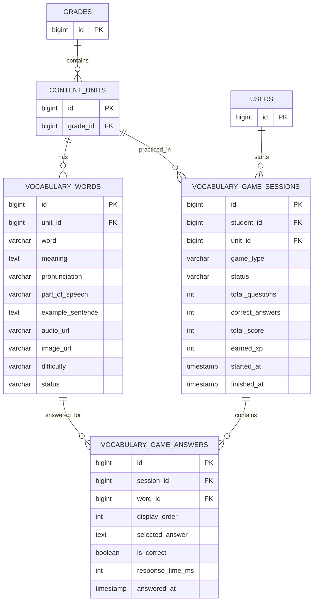

# Kế hoạch xây dựng Mini Game học từ vựng tiếng Anh
## Repository: `XuanDongVo/E-Learning` — Branch: `truong`

**Mục đích tài liệu:** Đưa cho AI coding agent đọc để hiểu hiện trạng, phạm vi và thiết kế đề xuất trước khi triển khai.

> **RÀNG BUỘC QUAN TRỌNG — CHƯA ĐƯỢC PHÉP CODE**
>
> Tài liệu này chỉ là bản phân tích và kế hoạch đề xuất. Chưa có sự chấp thuận triển khai.
> Agent chỉ được đọc, phân tích và phản hồi các điểm chưa rõ. **Không chỉnh sửa file, không tạo migration, không sinh code, không chạy lệnh ghi dữ liệu, không commit và không push** cho đến khi người dùng xác nhận rõ ràng.

---

## 1. Bối cảnh và hiện trạng dự án

Qua rà soát branch `truong`, dự án có cấu trúc công nghệ chính:

- Frontend: Next.js / React / TypeScript.
- Backend: Java Spring Boot.
- Database: PostgreSQL.
- Quản lý schema: Flyway migrations.
- Hibernate được cấu hình theo hướng validate schema, vì vậy cấu trúc database cần được cập nhật bằng migration tương ứng.

Các thành phần hiện có có thể tái sử dụng:

- `grades`: danh sách khối/lớp học.
- `content_units`: đơn vị bài học; mỗi Unit liên kết với một Grade thông qua `grade_id`.
- Cấu trúc nội dung hiện có gồm Section, Topic và các thành phần câu hỏi/question bank.
- Hệ thống gamification và XP đã có sẵn.
- `ActivityXpRewardWorkflow` có luồng trao thưởng XP; cần tận dụng thay vì tạo hệ thống XP thứ hai.
- Các loại nguồn XP hiện có gồm `PRACTICE`, `STREAK_BONUS`, `LEVEL_UP_BONUS`, `MANUAL`, `OTHER`.
- Student app hiện có các route như assignments, profile, progress, rewards và units. Chưa thấy route games hoặc thư mục feature game trong phần student đã rà soát.

Các đường dẫn tham khảo:

- Repository: https://github.com/XuanDongVo/E-Learning
- Branch: `truong`
- Grade entity: https://github.com/XuanDongVo/E-Learning/blob/truong/server/src/main/java/e_learning/server/grades/entity/Grade.java
- Unit entity: https://github.com/XuanDongVo/E-Learning/blob/truong/server/src/main/java/e_learning/server/content/unit/entity/Unit.java
- Student navbar: https://github.com/XuanDongVo/E-Learning/blob/truong/client-e-learning/src/components/layout/student-navbar.tsx
- Gamification package: https://github.com/XuanDongVo/E-Learning/tree/truong/server/src/main/java/e_learning/server/gamification
- Flyway migrations: https://github.com/XuanDongVo/E-Learning/tree/truong/server/src/main/resources/db/migration

Lưu ý: đây là kết quả rà soát các phần liên quan, không phải cam kết rằng toàn bộ repository đã được audit từng file.

---

## 2. Mục tiêu tính năng

Xây dựng khu vực mini game để học sinh ôn tập từ vựng tiếng Anh theo cấu trúc chuẩn Parroto (`parroto.app`):

**Games (Taskbar) → Chọn Grade → Chọn Unit → Chọn loại game (Bubble Pop / Word Rain) → Chơi Fullscreen → Báo cáo từ vựng**

### Các trò chơi hoàn thiện (Chuẩn Parroto):
1. **Bubble Pop (Bắn bong bóng từ vựng):**
   - Nghĩa tiếng Việt hiển thị trên đỉnh màn hình kèm nút loa phát âm.
   - Các bong bóng từ tiếng Anh rực rỡ trôi nổi.
   - Chạm/click đúng từ -> Nổ bong bóng "Pop!" kèm hiệu ứng nổ nước, tăng combo điểm.
   - Chạm sai -> Rung lắc nhẹ, không phạt mất mạng, cho phép chọn lại.
2. **Word Rain (Mưa từ vựng):**
   - Giọt mưa mang nghĩa tiếng Việt rơi từ đám mây xuống.
   - Học sinh gõ chữ cái trên bàn phím (hoặc bàn phím ảo trên tablet/mobile).
   - Cơ chế gợi ý thông minh (Scaffolding): Khi giọt mưa rơi xuống thấp, các chữ cái gợi ý sẽ lần lượt hé lộ để học sinh không bị bí từ.
   - Chạm đáy: Tự mở đáp án đúng + phát âm để học sinh học, không dừng game (Zero Penalty).
3. **Giao diện Fullscreen:**
   - Chế độ chơi tràn màn hình (Fullscreen) tập trung tối đa, không bị xao nhãng bởi thanh điều hướng.
   - Có nút bật/tắt toàn màn hình trình duyệt, nút âm thanh, nút thoát có xác nhận an toàn.
   - Màn hình kết thúc tổng kết danh sách "Từ đã nhớ tốt" và "Từ cần ôn lại" (kèm loa nghe lại phát âm).

---

## 3. Thiết kế dữ liệu đề xuất

### 3.1. Nguyên tắc

- Tái sử dụng `grades`, `content_units`, `users` và hệ thống XP hiện có.
- Không tạo lại bảng Grade hoặc Unit.
- Không thêm `grade_id` vào bảng từ vựng vì có thể lấy Grade thông qua `content_units.grade_id`.
- Tách dữ liệu từ vựng, phiên chơi và câu trả lời thành các bảng riêng.
- Lưu câu trả lời theo từng phiên để có thể xem lại lịch sử và thống kê.
- Không tạo bảng tiến độ từ vựng riêng ở giai đoạn đầu; có thể suy ra từ lịch sử câu trả lời. Chỉ bổ sung sau nếu triển khai ôn tập từ yếu hoặc spaced repetition.

### 3.2. Các bảng đề xuất

#### A. `vocabulary_words`

Lưu từ vựng thuộc một Unit.

| Cột | Ý nghĩa |
|---|---|
| `id` | Khóa chính |
| `unit_id` | FK đến `content_units.id` |
| `word` | Từ/cụm từ tiếng Anh |
| `meaning` | Nghĩa tiếng Việt |
| `pronunciation` | Phiên âm, có thể null |
| `part_of_speech` | Từ loại, có thể null |
| `example_sentence` | Câu ví dụ, có thể null |
| `audio_url` | Đường dẫn audio, có thể null |
| `image_url` | Đường dẫn hình minh họa, có thể null |
| `difficulty` | Mức độ khó, nếu cần |
| `status` | Trạng thái hiển thị/nháp |
| `created_at` | Thời điểm tạo |
| `updated_at` | Thời điểm cập nhật |

Ràng buộc và lưu ý:
- `unit_id` là khóa ngoại đến Unit.
- Nên có index cho `unit_id` và trạng thái.
- Cân nhắc unique theo `(unit_id, word)` sau khi thống nhất quy tắc chuẩn hóa chữ hoa/chữ thường.
- Chỉ từ ở trạng thái được phép sử dụng mới xuất hiện trong game.

#### B. `vocabulary_game_sessions`

Lưu mỗi lần học sinh bắt đầu chơi.

| Cột | Ý nghĩa |
|---|---|
| `id` | Khóa chính |
| `student_id` | FK đến người dùng/học sinh |
| `unit_id` | FK đến Unit |
| `game_type` | Loại game: matching hoặc quiz |
| `status` | Trạng thái: in progress, completed, abandoned |
| `total_questions` | Tổng số câu/từ trong phiên |
| `correct_answers` | Số câu đúng |
| `total_score` | Điểm phiên chơi |
| `earned_xp` | XP được trao cho phiên |
| `started_at` | Thời điểm bắt đầu |
| `finished_at` | Thời điểm kết thúc, có thể null |

#### C. `vocabulary_game_answers`

Lưu từng mục từ/câu hỏi được đưa vào phiên chơi và câu trả lời của học sinh.

| Cột | Ý nghĩa |
|---|---|
| `id` | Khóa chính |
| `session_id` | FK đến `vocabulary_game_sessions.id` |
| `word_id` | FK đến `vocabulary_words.id` |
| `display_order` | Thứ tự xuất hiện |
| `selected_answer` | Đáp án học sinh chọn/nhập |
| `is_correct` | Đúng hay sai; null nếu chưa trả lời |
| `response_time_ms` | Thời gian phản hồi, có thể null |
| `answered_at` | Thời điểm trả lời, có thể null |

Bảng này giúp phân biệt:
- Chưa trả lời.
- Đã trả lời đúng.
- Đã trả lời sai.

Cần xác định constraint phù hợp, ví dụ unique `(session_id, word_id)` nếu một từ chỉ xuất hiện một lần trong một phiên.

### 3.3. ERD logic



**Lưu ý về ERD:** Đây là sơ đồ logic để thống nhất thiết kế. Agent phải kiểm tra kiểu dữ liệu, tên khóa chính, tên bảng người dùng và quy ước naming thực tế trong repository trước khi triển khai. Không tự giả định `USERS.id` là `bigint` nếu schema hiện tại dùng kiểu khác.

---

## 4. Luồng nghiệp vụ

### 4.1. Chọn nội dung

1. Học sinh mở mục Games.
2. Backend trả về các Grade phù hợp.
3. Học sinh chọn Grade.
4. Backend trả về các Unit thuộc Grade có từ vựng khả dụng.
5. Học sinh chọn Unit.
6. Frontend hiển thị số lượng từ và loại game có thể chơi.

### 4.2. Bắt đầu phiên chơi

1. Frontend gửi yêu cầu tạo session với `unitId`, `gameType` và số lượng câu mong muốn.
2. Backend xác thực người dùng hiện tại từ JWT/security context.
3. Backend xác minh Unit tồn tại và học sinh được phép truy cập.
4. Backend chọn ngẫu nhiên hoặc theo quy tắc các từ hợp lệ.
5. Backend tạo session và các bản ghi answer tương ứng.
6. Backend trả về dữ liệu cần thiết cho màn chơi.

Không tin `studentId` do frontend gửi lên. Danh tính học sinh phải lấy từ thông tin xác thực phía server.

### 4.3. Trả lời và kết thúc

1. Học sinh gửi đáp án.
2. Backend xác minh session thuộc học sinh hiện tại và vẫn đang hoạt động.
3. Backend tự chấm đáp án dựa trên dữ liệu lưu phía server.
4. Backend cập nhật answer và thống kê session.
5. Khi hoàn tất, backend đóng session, tính điểm và XP.
6. XP được trao qua workflow gamification hiện có.
7. Frontend hiển thị kết quả và cho phép chơi lại hoặc về danh sách game.

Không để frontend tự quyết định `isCorrect`, `totalScore` hoặc `earnedXp`.

---

## 5. API đề xuất

Các endpoint dưới đây là đề xuất, cần đối chiếu convention hiện tại của backend trước khi chốt.

| Method | Endpoint | Mục đích |
|---|---|---|
| GET | `/v1/student/games/grades` | Lấy danh sách Grade |
| GET | `/v1/student/games/grades/{gradeId}/units` | Lấy Unit theo Grade |
| GET | `/v1/student/games/units/{unitId}/words` | Xem thông tin/số lượng từ khả dụng |
| POST | `/v1/student/games/sessions` | Tạo phiên chơi |
| POST | `/v1/student/games/sessions/{id}/answers` | Gửi câu trả lời |
| POST | `/v1/student/games/sessions/{id}/finish` | Kết thúc phiên |
| GET | `/v1/student/games/history` | Xem lịch sử chơi |

Cần thống nhất DTO request/response, phân trang lịch sử và cách trả lỗi theo chuẩn API hiện hữu.

---

## 6. Tổ chức backend đề xuất

Package mới có thể đặt tại:

```text
server/src/main/java/e_learning/server/vocabularygame/
  controller/
  dto/
  entity/
  repository/
  service/
  enums/
```

Vai trò dự kiến:

- `controller`: nhận request và trả response.
- `dto`: request/response objects.
- `entity`: ánh xạ các bảng mới.
- `repository`: truy vấn dữ liệu.
- `service`: xử lý tạo session, chọn câu, chấm điểm, kết thúc phiên.
- `enums`: loại game, trạng thái session, trạng thái từ vựng.

Tên package và class cuối cùng phải theo convention của các module đang tồn tại.

---

## 7. Tổ chức frontend đề xuất

Route:

```text
client-e-learning/src/app/[locale]/student/games/
  page.tsx
  [sessionId]/
    page.tsx
```

Components:

```text
client-e-learning/src/components/features/student/game/
  games-view.tsx
  grade-selector.tsx
  unit-selector.tsx
  game-selector.tsx
  word-matching-game.tsx
  vocabulary-quiz-game.tsx
  game-result.tsx
  game-history.tsx
```

Service:

```text
client-e-learning/src/services/student/
  student-vocabulary-game.service.ts
```

Đây là cấu trúc gợi ý. Agent cần xem cách dự án tổ chức route, component, API service, localization và UI hiện tại trước khi quyết định vị trí chính xác.

### Màn hình chính

- Danh sách Grade.
- Danh sách Unit của Grade.
- Thẻ chọn loại game.
- Số lượng từ có thể luyện tập.
- Lịch sử chơi gần đây.

### Màn hình chơi

- Hiển thị tiến độ, ví dụ câu 3/10.
- Hiển thị từ/câu hỏi.
- Nhận câu trả lời.
- Phản hồi đúng/sai.
- Chuyển câu tiếp theo.

### Màn hình kết quả

- Tổng số câu.
- Số câu đúng/sai.
- Điểm.
- XP nhận được.
- Nút chơi lại và quay về danh sách game.

---

## 8. XP và tính điểm

**Nguyên tắc:** Tái sử dụng `ActivityXpRewardWorkflow` và cơ chế XP hiện có. Không tạo bảng XP hoặc hệ thống cộng XP riêng nếu hệ thống hiện tại đã đáp ứng.

Công thức điểm/XP chỉ là ví dụ để thảo luận, chưa phải yêu cầu đã chốt:

- Mỗi câu đúng: +5 điểm.
- Hoàn thành phiên: +10 điểm thưởng.
- Đạt 10/10: +10 điểm thưởng thêm.

Trước khi triển khai cần xác định:
- Điểm và XP có phải cùng một giá trị hay không.
- Giới hạn XP mỗi phiên/ngày.
- Có thưởng cho chơi lại cùng một Unit hay không.
- Cách chống cộng XP trùng khi client gửi finish nhiều lần hoặc retry request.
- Nguồn XP phù hợp trong enum hiện có; nếu cần enum mới thì phải đánh giá tác động tới các nơi đang sử dụng enum.

Mọi thao tác trao XP phải có tính idempotent để tránh nhận thưởng nhiều lần cho cùng một session.

---

## 9. Database migration

- Giữ nguyên các migration Flyway hiện có V1–V52.
- Migration cấu trúc: `V53__create_vocabulary_and_game_tables.sql`.
- Migration seed dữ liệu: `V54__seed_vocabulary_words.sql` (nạp sẵn 22 từ vựng mẫu chuẩn SGK cho Grade 6 Unit 1 & Unit 2, tạo Unit cho Grade 7 & 8).
- Migration chỉ chứa DDL: tạo bảng, khóa ngoại, unique constraints và index.

---

## 10. Bảo mật và tính toàn vẹn

Các kiểm tra bắt buộc:

- `studentId` phải lấy từ JWT/security context, không lấy từ payload frontend.
- Học sinh không được đọc hoặc thao tác session của người khác.
- Session phải thuộc đúng học sinh và đúng Unit.
- Không nhận kết quả chấm đúng/sai do frontend tự khai báo.
- Không cho trả lời sau khi session đã hoàn tất.
- Không cho gửi một answer nhiều lần nếu nghiệp vụ không cho phép.
- Không trao XP nhiều lần cho một session.
- Không trả từ vựng ở trạng thái nháp/không hoạt động.
- Xác minh dữ liệu đầu vào và giới hạn số câu mỗi phiên ở server.

---

## 11. Kiểm thử cần có

### Dữ liệu và lựa chọn nội dung

- Grade không có Unit.
- Unit không có từ vựng.
- Unit không thuộc Grade được yêu cầu.
- Từ vựng ở trạng thái draft không xuất hiện.
- Unit có ít từ hơn số câu yêu cầu.

### Session và answer

- Tạo session hợp lệ.
- Không truy cập session của người khác.
- Gửi đáp án đúng/sai.
- Gửi đáp án trùng.
- Bỏ qua một câu.
- Thoát giữa chừng.
- Gửi answer sau khi session hoàn tất.
- Gọi finish nhiều lần.

### XP và lịch sử

- Session hoàn tất chỉ nhận XP một lần.
- Retry request không nhân đôi XP.
- Lịch sử của mỗi học sinh được tách biệt.
- Thống kê kết quả khớp với answer records.

### Frontend

- Loading, empty state và error state.
- Unit không có từ.
- Người dùng refresh hoặc rời màn chơi.
- Responsive và localization theo chuẩn dự án.

---

## 12. Các quyết định còn cần người dùng xác nhận

Các mục sau chưa được chốt. Agent không được tự coi các giá trị mặc định là quyết định cuối cùng:

1. **Loại game MVP:** Matching + Quiz là đề xuất ban đầu. Có thêm game nhập từ (typing) ngay không?
2. **Nguồn từ vựng:** Tạo bảng từ vựng riêng hay tái sử dụng Question Bank hiện tại? Đề xuất ban đầu là bảng riêng để mô hình từ vựng tự nhiên và dễ mở rộng.
3. **Quản trị dữ liệu:** Ai tạo/sửa từ vựng — admin, giáo viên hay seed dữ liệu trước?
4. **Lịch sử:** Có hiển thị lịch sử các lần chơi cho học sinh không? Đề xuất: có.
5. **Số câu mỗi lượt:** 10, 15, 20 hay cấu hình được? Đề xuất ban đầu: 10 câu.

---

## 13. Trình tự triển khai sau khi được duyệt

Chỉ thực hiện sau khi người dùng phê duyệt rõ ràng:

1. Audit sâu các entity, repository, security, API response, migration và frontend convention liên quan.
2. Chốt ERD, kiểu dữ liệu, constraints và naming.
3. Chốt nghiệp vụ game, scoring, XP và API contract.
4. Viết migration mới, không sửa migration cũ.
5. Xây dựng backend entity/repository/service/controller/DTO.
6. Xây dựng frontend route, components và API service.
7. Tích hợp XP hiện có.
8. Viết/chạy test phù hợp.
9. Báo cáo các file đã thay đổi, migration, test result và các điểm còn tồn tại.
10. Chỉ commit/push khi người dùng yêu cầu riêng.

---

## 14. Chỉ dẫn dành cho AI coding agent

Trước tiên, hãy đọc tài liệu này và kiểm tra lại repository `XuanDongVo/E-Learning`, branch `truong`, ở chế độ chỉ đọc.

**Việc được phép làm ở giai đoạn hiện tại:**
- Đọc source code và cấu trúc dự án.
- Đối chiếu thiết kế đề xuất với code thực tế.
- Nêu điểm không khớp, rủi ro, thiếu sót và câu hỏi cần xác nhận.
- Đề xuất điều chỉnh ERD/API/package nếu có căn cứ từ repository.
- Trả về kế hoạch triển khai theo từng bước, kèm danh sách file dự kiến sẽ tạo/sửa.

**Việc chưa được phép làm:**
- Không tạo hoặc sửa bất kỳ file nào trong repository.
- Không viết code triển khai.
- Không tạo migration.
- Không chạy formatter hoặc generator có thể thay đổi file.
- Không commit, push, merge hoặc mở PR.
- Không tự ý thay đổi schema/database.
- Không tự chọn thay người dùng các quyết định còn bỏ ngỏ ở mục 12.

Kết quả cần trả về trước khi chờ phê duyệt:
1. Những điểm trong kế hoạch khớp với code hiện tại.
2. Những điểm cần chỉnh sửa sau khi audit.
3. ERD cuối cùng được đề xuất (nếu có thay đổi thì giải thích).
4. API contract và danh sách file dự kiến tác động.
5. Rủi ro, test plan và các quyết định cần người dùng xác nhận.

**Dừng lại sau khi gửi báo cáo. Chờ người dùng phê duyệt trước khi bắt đầu bất kỳ thay đổi nào.**
